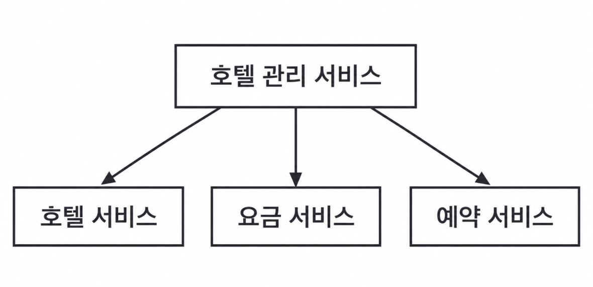

## 배경
1. 호텔, 요금, 예약 도메인별로 서비스가 분리된 msa이다.
2. 객실 read : 예약 상세 read : 예약 write = 100:10:1  (단위: qps)
   -> 읽기/쓰기 비율이 이론적으로 110:1인 읽기 중심 서비스이다.
3. 객실 가격은 유동적이다
4. 예상 예약은 3 TPS 발생한다.

### 어떤 저장소를 써야할까 (=데이터의 특징이 어떤가?)
- 데이터는 자주 읽히며, 드물게 쓰인다.
- 도메인 특성상, 데이터 신뢰성/무결성을 위해 acid 보장이 중요하다.
- 데이터간 관계가 뚜렷하다
- 그래서 엔진레벨에서 위를 모두 최적화/지원하는 rdb를 선택하는것이 타당하다

### 인벤토리 단위의 관리
 - 호텔 예약은, 에어비엔비와 달리 방 번호를 예약는게 아니라 방의 유형(스탠다드, 킹 ..)을 예약한다. 방 번호는 체크인 시 부여된다.
 - 그래서 적어도, 예약 주기에서는 방 번호를 고려하는 것이 아닌 방 유형을 고려해야한다.
 - 만약, 에어비엔비 였다면 방마다 레코드가 있고 그것을 참조하여 예약하는 방식이 일반적일 것이다
 - 하지만 호텔은 방의 개수, 인벤토리라고 표현할 수 있는 정수 단위로 예약을 관리하면 된다.

### 데이터를 어떻게 저장해두는게 좋을까
- 데이터의 접근 빈도를 비교해보면, 일반적으로 '다가올 날의 예약/호텔 데이터'에 비해 '지난 날의 예약/호텔 데이터'는 아주 드물게 접근될 것이다. 
- 그래서 이런 도메인 특성상, 지난 날의 데이터들은 cold storage로 옮겨서 rdb의 레코드 수를 줄여나가는 것이 여러 측면에서 유리하다.

### 동시성과 멱등성
**type A. 같은 사용자가 예약 요청을 여러번 보냄**
간단한 멱등성을 위한 장치가 필요하다. 이런 장치는 보통, 사용자 인간의 실수나 네트워크 불량 등으로 발생하기 때문이다. 다양한 방법이 있는데, 예약 화면에 key를 부여하고 해당 key의 예약화면에서 2개 이상의 예약이 발생하면 block하면 된다.

**type B. 여러 사용자가 동시에 예약 요청을 보냄**
도메인 특성상, 하나의 방번호를 갖고 갱신하는게 아니라 티켓팅처럼 잔여 방 개수를 가지고 경쟁하기 때문에, 문제가 되는건 잔여석이 1->0 넘어가는 순간이다.

디비는 내부적으로 수정 연산을 read하고 그 read한 값을 수정해서, write하는데 read/write가 여러 사용자가 엇갈린다면 얼마든지 동시성 위반이 발생한다.

어떻게 잘 하면, application 레이어에서 우아하게 동시성 위반을 해결해볼만도 하지만 위반 상황은 하나가 아니다. 아주 많으며, 그래서 예상치 못하는 것도 많을 것이다. 그래서 db 레이어의 lock이 가장 합리적이다.

- 비관적락
	1. 레코드를 갱신하려는 순간, 락테이블에 트랜잭션 A가 해당 레코드를 잠군다라는 걸 기록한다
	2. 다른 트랜잭션은 매번 쿼리 실행 직전 락테이블을 조회하는데, A가 잠금을 풀때까지 (=커밋되기 전까찌) 해당 레코드를 못건든다
	3. 즉, 레코드 단위로 소유권이 왔다갔다하는거라서 동시성을 보장한다.
	4. 구현이 아주 쉽지만, 로직에 따라 데드락 위험이 있고 오랜 시간 해당 자원을 획득하지 못하는 고아 트랜잭션이 발생할수도잇다
	> 궁금했던점. 락테이블에 "레코드 X는 트랜잭션 A거"를 쓰는거면, 이 락테이블에 쓰는것 마저도 동시성 위반이 생길수 있는거 아닌가?
	> 
	> -> 디비 동시성을 걱정해야했던 이유는 애플리케이션 레벨에 쓰기였기 때문인데, 락테이블에 쓰는건 무조건 cpu 레벨에서 하기 때문에 아토믹하다고 한다. (cas 방식)
	
- 낙관적락 
	1. 여러 사용자가 동시에 데이터를 수정하려하는 것을 허용한다
	2. 수정 빈도가 낮은 경우, 비관적락처럼 굳이 디비락을 거는건 과투자이고 그래도 동시성 제어는 필요하다 싶을 때 쓴다
	3. 데이터베이스 테이블에 버전 레코드를 추가해서, 버전1의 값을 읽고 -> 수정해서  -> 버전2로 저장하는데 이때, 버전2가 이미 존재하면 충돌이 발생한것이기에 트랜잭션을 어보트한다.
	4. 그래서 이건 애플리케이션이나 orm이 직접 구현하는 경우가 많다

- 디비 컨스트레인트
	1. 디비에 전역적인 제약 조건을 거는건데
	2. 마찬가지로 구현이 쉽지만, 일부 dbms는 지원을 안한다
	3. 마찬가지로 경쟁이 심할땐 실패하는 연산수가 많다. 그래서, 낙관락도 마찬가지인데 이런 특성의 데이터는 그냥 비관락 걸어서 실패하는것보다, 기다리게하는게 낫다.

### 캐싱을 하자
- 앞서 말했다시피, 읽기가 압도적으로 많은 서비스기에 캐싱을 통해 얻는 이익이 클것이다
- 이때 해결해야할 문제는, rdb와 캐시디비 사이의 일관성 보장이다.
- 그래서 캐시를 신뢰해서 비즈니스 로직이 거기에 과하게 기대어선 안된다.

### 분산 트랜잭션
- 이 시스템은 msa이다. 즉, 단편적으로 보더라도 잔여 객실 조회와 객실 예약은 디비 트랜잭션으로 묶을 수가 없다.
- 그래서 해야하는게 분산 트랜잭션인데
- 2pc, saga 등이 있다

1. 2pc
	- 여러 디비에 걸친 트랜잭션을 보장하는 데이터베이스 프로토콜이다. 
	- 결합도가 높으며 느리다.
	- msa 철학과 잘 안맞아서 msa는 잘 안쓰인다.
	- 그런데 금융 원장처럼 강한 결합도가 필요한 서비스는(복구할거여도, 찰나의 어긋남을 허락못함) 처리량/가용성을 포기하더라도 이거 써야한다
2. saga
	- A->B가 하나의 논리적 트랜잭션이어야하는데, A는 B가 언제 끝날줄 알고 기다리냐?라는 철학에서 나온 트랜잭션 패턴
	-  분산트랜잭션이 겪은 문제는 여러 노드의 행동을 하나의 논리적 트랜잭션으로 묶기가 어렵다 였고, 사가의 해결책 또한 트랜잭션을 쪼개어 각각의 결합도를 느슨하게 만드는 것이었기 때문이다.
	- 그러다보니, 분산 트랜잭션과 굉장히 핏하다
	- 절차
			-   t1,t2,t3,...,tn을 하나의 논리적 트랜잭션으로 묶고 각각을 순차적으로 수행한다
			-  t3가 실패했다면 역순으로 t2, t1에게 각각 c2, c1이란 '보상'을 지급.
			- 그 보상이라함은 연산 취소 등이 잇겟지?
	- 이러한 "일단 난 할거고, 끝까지 안되면 보상받겟다"라는 흐름 때문에 결과적인 일관성을 보장될지언정 중간에 어긋남이 사용자에게 보여질수있긴하다.

