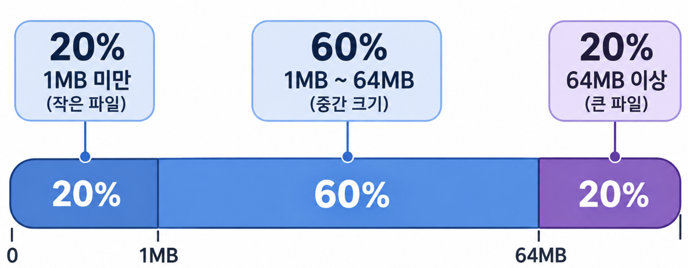

### 객체저장소는 어떤 저장소 인가?
저장소 시스템엔 크게, block/file/object 저장소가 있다.

객체저장소는 데이터의 영속성(사라지지 않는 특성)을 위해 만들어진 저장소이다. 즉, "낮은 비용으로 높은 영속성을 획득하기 위한" 저장소이다. 단, 그것을 위해 포기한 것이 성능이다. 

이러한 특성으로 인해 cold storage로써 활용하기가 가장 적절한 저장소 타입이라고 볼 수 있다.

> 링크드인에서 조사한 바에 따르면, 객체 저장소의 request 95%가 read였다고 한다.

### 객체저장소가 update 기능을 포기한 이유
어떤 자원을 수정하고자 할때 기본적으로 내부적으로 처리해야할 것이 원자성, 동시성 등이 있다. 이것들은 데이터의 정합성이나 안정성을 위해 쓰기 성능을 일부 포기하게 된다.

객체저장소의 철학을 다시 생각해보자.
다른 저장소를 안쓰고 객체저장소를 쓰는 이유는 "저비용, 고영속성"을 위함이다. 즉, 백업 데이터 등을 어딘가에 안전하게 저장해두기 위한 장치이다.

그렇기 때문에, 성능을 포기하는 것은 합리적이며 update 기능 도입에 의해 저하되는 쓰기 성능을 받아들였을 때 얻는 시스템의 단순함, 읽기 성능이 목적에 더 부합한 이익이다.

### 시스템 배경

- 20%는 0~1MB, 60%는 1MB~64MB, 20%는 64MB~ 이다.
- 디스크 하나가 100~150 iops 를 지원한다.

### 객체저장소 설계철학
- unix file system과 아주 유사하다
- unix에선 실제 데이터가 있는 파일과, 그 파일을 표현하는 inode라는 메타데이터같은 것을 따로 둔다.
- 이렇게하면, 비록 어떤 파일에 접근해야할때 inode를 읽고 거기서 또 블록 포인터 목록을 얻고 그 포인터를 따라가서 실제 데이터를 얻어야한다는 점에서 다소 비효율적으로 보이지만, 설계와 관리가 아주 단순해지며 저장 효율이 올라간다.
- 객체저장소도 마찬가지인데, 객체저장소의 실제 데이터는 불변이지만 메타데이터 파일은 가변적이다. 이를 통해서 파일의 이름이 바뀌거나 할때 파일을 re-write하지 않아도되며 메타데이터 컴포넌트/실제데이터 컴포넌트 를 나눠도 되는 등의 이점을 얻는다.

### placement service와 데이터 다중화
- 데이터 다중화를 위해, 여러개의 노드에 데이터를 복제한다.
- 이때 배치(placement) 서비스가 중간에서 이를 관리하는데, 주로 하는 일은 다음과 같다
    - 모든 노드 헬스체크 -> 이것을 통해 내부적으로 virtual cluster map을 유지함
    - 프라이머리/세컨더리 노드 선정 (리플리카가 물리적으로 다른 곳에 놓이게 하기)
- 물론, 데이터 라우팅 서비스가 디스크에 직접 접근할것이며 배치서비스가 없어도 데이터가 유실된다거나 하는 문제는 없지만 이 이전에 배치서비스가 동작하지 않으면 저장소의 서비스가 중단될 것이다. 그래서 저자는 배치서비스를 여러개 두어 합의 알고리즘이 녹아든 배치서비스 클러스터를 구축하라고 한다

### 데이터 라우팅 서비스 
- 배치 서비스는 "어디로 가라"라고 알려주는 서비스이고 접근 요구를 받으며 실제로 가서, 데이터를 집어넣는 행위를 하는건 데이터 라우팅 서비스이다. 이떄, 다중화에 대한 책임도 이 서비스에 있는데(다중화에 대한 설계는 배치서비스가 한다고 보는게 맞으나 실제로 그것을 수행하고 잘되었음을 보장하는건 데이터라우팅서비스) 이때 object id(uuid format)를 활용하여 consistent hash를 활용하여 '다중화 그룹'을 얻을 수 있다

- 다중화에 대한 책임이라고 하는건, exactly-once, at-least-once, at-most-once 개념과 전혀 다르지 않다.
    - 일관성과 레이턴시 사이 트레이드 오프

### 데이터 구겨넣기
- 1개 객체 = 1개 파일로 두지 않는다
    - 디스크의 블록은 보통 4kb이며 불변적이다
    - 4kb보다 작은 파일이 많으면 4kb를 다 못쓰기에 낭비되는 것이며
    - 설령 크다고 하더라도, 4kb의 배수로 나누어 떨어지지 않는 경우가 많기에 공간 낭비가 발생한다
    - 1객체 1파일이면 당연히, inode도 많아지는데 디스크에서 사용가능한 아이노드의 수가 한정적이며 작은파일이 빼곡히 많으면 inode가 소진될 것이다.
- 하나의 커다란 파일에 여러개의 파일을 구겨 넣는다.
- 이러면 파일이 N개 존재할 때, N-1개는 읽기 전용, 1개는(현재 쓰기를 받고 있는 파일) 읽기/쓰기 전용으로 둘 수 있다.
- 이때 우려되는 것은 멀티 코어 쓰기 동시성 이슈이다.
    - 1코어 = 1쓰는 파일 을 두어 (반드시 현재 읽기/쓰기 파일이 하나만 있을 필욘 없으니깐) 해결한다
- 이렇게 했을 때 해결해야할 문제는 "파일 안에서 내가 찾는 객체 찾기"이다.
    - 파일, 오프셋, 객체 크기 (아주 일반적인 자료구조와 동일하다)가 필요하다.
    - 이러한 '소재' 기억을 위해서 객체위치데이터베이스를 별도로 둔다. (관계형 db가 적절하다)

### 하드웨어 가용성
- 일반적으로 데이터센터 내부는, az-rack-node 구조이다. 
- az가 다르다는 것은, 독립적인 전원/네트워크 설비를 가진다는 의미이다.
- 데이터센터에 미사일이 떨어지면 모든 az가 죽는다. 그러면 여러 데이터센터에 분산을 고려해야하기도 한다
- 모든 서비스가 멀티 az, 멀티 dc를 해야하는가?는 당연히 아니다. 발생확률 x 위험 + 비즈니스(시스템) 맥락에 따른 직관으로 적절한 재해복구 시스템을 마련해야한다

### erasure coding
- 데이터 3중 다중화는 이론적으로 6nine 수준의 내구성을 달성한다
- erasure coding으로 계산 해봤을땐 11nine 수준이라고 한다
- 이건 데이터를 똑같은걸 무식하게 여러개 두자는게 아니라, 데이터를 쪼개고 pairty를 만드는 방식이다.
- n개의 조각이 있을때 n/2조각을 parity로 지정하여 최대 n/2개의 조각을 유실하더라도 parity를 통해 나머지를 복구할수있다는 아이디어인데
- 3중 다중화는 300% 저장인 반면 이 방식은 150% 저장이라는 점에서 비용측면에서는 아주 합리적이다. 
- 다만 이 방식은, parity 계산에서 일단 cpu overhead가 있으며 하나의 정보를 여러개로 쪼개는 것이기에 r/w 성능이 모두 나빠진다.

### 메타데이터 디비 샤딩
- 메타데이터라고 함은, 버킷 메타데이터, 객체 메타데이터가 있다.
- 이때 버킷은 인당 버킷 수 제한이 있다고 하면, 어느정도 그 수가 예측이 되며 많지 않을 것이다.
- 다만, 오브젝트 메타데이터는 디비 서버 한대에 넣기 어려울 가능성이 높으며 샤딩이 필요하다
- 샤딩 기준 값을 뭐로 잡을 것인가?
    - bucket name + object name 이어야한다.
    - 모든 버킷에 비슷한 양의 데이터가 담길거란 보장이 없기에 버킷을 기준으로 정하는것은 비효율적이며
    - object id로 기준을 정하게 되면, "객체 이름"으로 검색하게되는 객체저장소 특성 상 질의 효율이 떨어진다
    - 객체 저장소는 버킷이름+객체이름 꼴로 경로를 정하기 때문에 (실제 계층적인 경로는 아니며 표면적인 경로) 버킷이름+객체이름을 기준으로 잡아서 샤딩하는 것이 검색 효율도 좋고, 고르게 분포시키기도 좋을 것이다.

### 버져닝과 GC
- 객체저장소는 기본적으로, 대부분의 경우 버전 관리를 지원한다
- 단순하다. 각 객체의 메타데이터 데이터에 버전 칼럼을 추가하는 것이다
- 객체를 삭제하더라도 soft delete를 하게되며 (메타데이터에 딜리트 마커추가) 과거 버전의 객체나 그 메타데이터를 절대적으로 유지한다.
- garbage collection이란 다음 세개 데이터를 주기적으로 정리(compaction)하여, 할당되어있던 공간을 회수 하는 작업이다
    - lazy object deletion: 삭제됐다고 표시되는데 실제로 안지워진거
    - orphaned data: 업로드되다가 말은 데이터
    - corrupted data: 체크섬 검사 실패한 데이터
- 앞서 이야기했듯, 객체저장소는 객체의 수정 개념이 없다.
- 컴팩션 과정에서는 정리 대상 공간에 삭제된 객체임을 알리는 flag 값을 true로 두고, 이것을 제외하여 나머지 객체들을 새로운 파일에 추가한다. 기존 파일은 삭제한다. 
    - 즉, 삭제하는게 아니라 삭제할거 뺴고 다른 데에 옮긴다는 것이 매커니즘에 대한 더 정확한 표현이다.

### multipart upload
- 큰 파일은 쪼개어 업로드 해야한다. 이걸 멀티파트 업로드 라고 하는데
- 각 조각마다 etag라는 무결성 검증하는 체크섬이 있다
- 이걸 써서 생기는 오버헤드는 쪼개고 합치는데 발생하는 프로세싱이다
- 그리고 한가지 걱정해야하는건 조각들의 조립이 끝나 최종 객체를 만들어냈을 때, 기존 조각들은 그것대로 필요없어진 채로 남는다. gc를 통해 이런 조각들이 정리되게 할필요가 있다.
